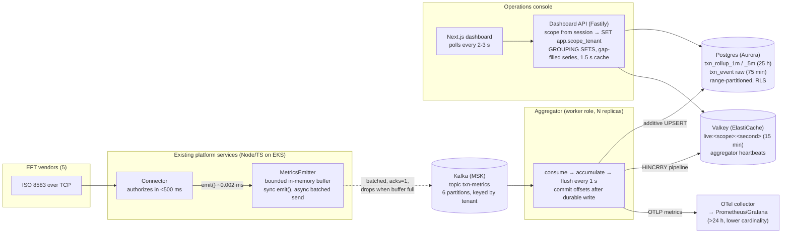

# Architecture

Near real-time operational dashboard for a multi-tenant ISO 8583 debit authorization platform. Rolling 24-hour view, a few seconds behind live, filterable by the attributes operators care about, with a tenant-scoped view for each bank and a platform-wide view for Nymbus operations.

For the reasoning behind each choice and the alternatives rejected, see [DECISIONS.md](DECISIONS.md). For how to run and operate it, see [RUNBOOK.md](RUNBOOK.md). For the live demo script, see [DEMO.md](DEMO.md).

## The one-paragraph version

The connector already sees every transaction. We add one non-blocking call there that drops a small metric event into an in-memory buffer. A background task batches those events onto a Kafka topic. An aggregator service consumes the topic and writes three things: additive 1-minute and 5-minute rollups to Postgres (the 24-hour, drill-down store), per-second buckets to Valkey (the "live" strip), and lower-cardinality metrics to the existing OpenTelemetry collector (the beyond-24-hour store in Grafana). The dashboard API serves the console, enforcing tenant scope in its queries and again with Postgres row-level security. The console polls every few seconds.

## Diagram

## Components

| Component | Where it lives in this repo | In production |
|---|---|---|
| **MetricsEmitter** | `packages/metrics-emitter` | A library imported by the connector. One call per completed transaction. |
| **Connector simulator** | `services/connector-sim` | Does not exist. Stands in for the EFT vendors *and* the connector so we can generate traffic and inject conditions. Its one real line is `emitter.emit(event)`. |
| **Aggregator** | `services/aggregator` | A worker role of the existing backend service (same codebase, its own deployment/replica set so it scales and restarts independently of the auth path). |
| **Dashboard API** | `services/api` | Routes added to the existing console backend. Identity comes from the console session instead of headers. |
| **Dashboard** | `apps/web` | A page inside the existing Next.js operations console. |
| **Schema + partition maintenance** | `packages/db` | Migrations and the rolling-partition job. |
| **Shared types and ISO 8583 reference data** | `packages/shared` | Shared package. |
| **OTel wiring** | `packages/otel` | Points at the platform's existing collector. |

## Data flow, step by step

1. **Connector completes a transaction.** The response has already gone back to the vendor. The connector calls `emitter.emit({ eventId, occurredAt, tenantId, vendor, sourceConn, msgType, txnFamily, outcomeCode, amount, latencyMs, stan, bin })`. That call pushes onto an array and returns. Measured cost: p99 around 2 microseconds, max under 20 microseconds. No PAN, no track data, no cardholder data is in the event.

2. **Emitter drains in the background.** Every 250 ms it takes up to 500 events off the buffer and sends them to Kafka as one batch, keyed by tenant, `acks=1`, up to 4 batches in flight. If the buffer reaches its cap (10,000 events, about 65 seconds at 150 tps) new events are dropped and counted. A failed send puts its batch back at the head of the buffer, marks the emitter disconnected and reconnects with backoff; the buffer then absorbs the outage until it fills. Nothing here can throw into, block, or back-pressure the connector.

3. **Kafka holds the stream.** Six partitions keyed by tenant: a tenant's events stay ordered on one partition, and the aggregator can run up to six replicas. 24-hour retention, which is far more than the aggregator will ever need to replay.

4. **Aggregator accumulates and flushes.** Each replica consumes its partitions, parses events, and adds them to in-memory accumulators: one map per rollup granularity keyed by (bucket, tenant, vendor, msg type, family, outcome), one map of per-second live buckets keyed by scope (all, tenant, vendor), and a list of raw events. Every second it swaps the accumulators out and writes them: additive `INSERT ... ON CONFLICT DO UPDATE SET count = count + EXCLUDED.count` into both rollup tables, multi-row `INSERT ... ON CONFLICT DO NOTHING` into the raw table, an `HINCRBY` pipeline into Valkey, then commits Kafka offsets. Only after the writes succeed. If a write fails, the events go back in front of the next flush and offsets stay uncommitted. If more than 50,000 events pile up unflushed, the replica pauses its Kafka fetch until it catches up; that pressure goes toward Kafka, never toward the connector.

5. **Aggregator also exports to OTel.** Per event it increments `txn_count{tenant, vendor, msg_type, outcome_class}` and records `txn_latency_ms{tenant, vendor}` into a histogram with the same bucket boundaries the Postgres rollups use. Outcome is reduced to its class (approved / soft decline / hard decline / system error / format error) to keep Prometheus series count sane. This is the >24-hour view, rendered in Grafana by the existing observability stack.

6. **Partition maintenance.** Once a minute the aggregator creates upcoming partitions and drops expired ones (details below). A try-lock means only one replica does it per tick.

7. **Dashboard API serves the console.** Every request carries an identity. The API opens a read-only transaction, sets `app.scope_tenant` to `*` (platform operator) or the tenant id, and runs its queries. Postgres row-level security policies on every table read that setting, so even a buggy query cannot leak another tenant's rows. The overview endpoint uses `GROUP BY GROUPING SETS` to get the grand total and five breakdowns from one scan. A 1.5-second in-memory cache collapses many operators watching the same view into one query.

8. **Dashboard polls.** Overview and time series every 3 seconds, the live strip every 2, events every 5, freshness every 3. The freshness badge shows "N seconds behind live", computed from aggregator heartbeats in Valkey. Clicking a bar on the traffic chart opens the raw transactions for that minute; clicking a breakdown row adds a filter.

## Data model

### Metric event (on Kafka, JSON)

Exactly the fields above. About 300 bytes. Small on purpose: the connector should never serialize anything an operator doesn't filter by.

### `txn_rollup_1m` and `txn_rollup_5m` (Postgres)

One row per (bucket, tenant, vendor, msg_type, txn_family, outcome_code) with `txn_count`, `amount_sum`, `latency_sum_ms`, `latency_max_ms`, and ten latency histogram bins (`<=50, <=100, <=150, <=200, <=300, <=500, <=750, <=1000, <=2000, >2000` ms). Everything is additive, so merging from many aggregator replicas is a sum, and percentiles for any filter are computed by summing bins and interpolating.

Hourly range partitions on `bucket_ts`; 25 retained so the oldest minute of "last 24 hours" is never mid-drop; 2 pre-created ahead.

The 1m table serves windows up to 2 hours; 5m serves 6h and 24h. Same shape, one fifth the rows. Writing both costs the aggregator one extra upsert per combo per flush.

### `txn_event` (Postgres)

The raw metric events, for "show me the transactions behind that spike". 15-minute range partitions, 5 retained (75 minutes) so "last hour" is always complete. Primary key (occurred_at, event_id) makes replay idempotent.

### Valkey

`live:<scope>:<epoch-second>` hashes, where scope is `all`, `t:<tenant>` or `v:<vendor>`. Fields: n, ok, dec, err, lat (sum), b0..b9 (histogram). 15-minute TTL. The API re-bins them into 5-second points for the last 5 minutes.

`metrics:aggregators` hash: one entry per live replica with its newest event time, last flush time and processed count. The freshness badge and a pipeline-health alert come from this.

### OTel / Prometheus

`txn_count_total{tenant, vendor, msg_type, outcome_class}`, `txn_amount_total{tenant, vendor}`, `txn_latency_ms_bucket{tenant, vendor, le}`, `aggregator_lag_seconds`, `aggregator_events_processed_total`, `metrics_emitter_emitted_total`, `metrics_emitter_dropped_total`, `metrics_emitter_buffer_size`, `connector_emit_overhead_p99_ms`.

## Multi-tenancy

Two audiences, one running system, so isolation is enforced in two places and the UI is not one of them:

- **API.** The caller's scope is resolved once per request. A tenant admin's scope wins over any `tenantId` query parameter they send. Tenant admins never see the top-tenants breakdown or platform-level traffic (the 0800 network-management messages are attributed to a reserved `platform` tenant).
- **Postgres.** The API connects as `dashboard_api`, a SELECT-only role. Policies on `tenant`, `txn_rollup_1m`, `txn_rollup_5m` and `txn_event` allow a row only when `app.scope_tenant` is `*` or equals the row's `tenant_id`. The setting is pinned with `set_config(..., true)` inside the request's transaction. A missing setting evaluates to NULL and returns nothing: fail closed. Policies on the parent table apply to every partition queried through it, so new partitions need no extra grants.
- **Valkey** live keys are scoped by tenant; the API picks the key from the resolved scope, not from user input.

## Capacity and upper bounds

The brief sizes for about 50 tenants, 5 vendors, 100-150 tps typical peak, 2-3M transactions per day. Designed headroom is 3x that, which the simulator can produce on demand (`traffic_surge`).

| Thing | At 150 tps | At 450 tps (3x) |
|---|---|---|
| Kafka ingress | ~45 KB/s, ~3.9 GB/day uncompressed | ~135 KB/s |
| Emitter buffer memory (10k events) | ~3 MB, ~65 s of outage tolerance | ~22 s of tolerance (raise `maxBuffer`) |
| Rollup rows written per flush (1 s) | ≤ ~150 per table, realistically 60-120 | ≤ ~450 |
| `txn_rollup_1m` rows per 24 h | ~1.5-2.5M (measured ~25-60 distinct combos per tenant-minute) | same order; combos saturate, not multiply |
| `txn_rollup_5m` rows per 24 h | ~0.4-0.6M | same |
| `txn_event` rows retained | ~0.7M (75 min) | ~2M |
| Valkey live keys | 56 per second × 900 s ≈ 50k keys, ~10 MB | same (keys are per scope, not per event) |
| Prometheus series | tenants × vendors × 6 msg types × 5 classes ≈ ≤ 1,500 for `txn_count`, plus 50 × 11 for the histogram | same |
| 24 h platform-wide overview query | ~0.5M rows from the 5m table, partition-pruned, one scan via GROUPING SETS. Measured with a full 24 h loaded (1.13M rows in 1m, 489k in 5m): 0.33 s in Postgres, 0.88 s end to end; 24 h time series 0.31 s; 1 h views ~0.1 s; tenant-scoped 24 h 0.05 s. | same |

Where the limits actually are, and what moves them:

- **Aggregator throughput.** One replica handles 450 tps with flushes well under the 1-second interval. Six partitions allow six replicas; raise the partition count to go further. Writes are additive so replicas never conflict.
- **Postgres write amplification.** Each flush is ~3 statements (two rollup upserts, one raw insert) plus a heartbeat, regardless of tps, because rows are pre-aggregated in memory. At 450 tps that's still ~1,500 rows/s of upsert, far below Aurora's ceiling.
- **Rollup cardinality.** Rows scale with *distinct combinations seen*, not with transactions. A tenant doing 15 tps and one doing 2 tps produce rollup rows of the same order. The ceiling per tenant-minute is 6 × 6 × 15 = 540 combos; observed is 25-60.
- **Query latency.** Partition pruning plus the 5m table keep the 24-hour platform-wide scan around half a million rows. If that ever became slow the next steps are a 1-hour rollup for the 24h chart and a materialized "last 24h totals" refreshed by the aggregator.
- **Dashboard fan-out.** The API cache turns N operators into one query per 1.5 s per distinct view. Beyond that, push (SSE over Valkey pub/sub) is the next step; see DECISIONS.md.

## Failure modes

| Failure | What happens to the auth path | What happens to the dashboard | Recovery |
|---|---|---|---|
| Kafka unreachable | Nothing. `emit()` keeps returning in microseconds. The first failed send puts its batch back and marks the emitter disconnected; the buffer then fills over ~65 s, after which the oldest events are dropped and counted. | Live strip stops advancing; freshness badge goes amber then red; Grafana shows `metrics_emitter_dropped_total` rising. | Emitter reconnects with backoff and drains the buffer. The aggregator rebuilds its consumer if kafkajs gives up (a broker restart can surface a non-retriable error) and resumes from committed offsets. Dropped events are gone, by design. |
| Aggregator crash | Nothing. | Freshness lag grows until a replica comes back. | Kafka retains the stream; the new replica resumes from the last committed offset. Up to one flush interval (1 s) of events may be re-applied; raw events dedupe on event id, rollups could double-count that second. A *graceful* stop (SIGTERM on deploy or scale-down) pauses fetching, flushes and commits before leaving the group, so it replays nothing. |
| Aggregator down for hours | Nothing. | Stale until it returns, then the 24-hour view fills in as it replays. | It replays from the last committed offset within Kafka's 24 h retention. Rollup buckets older than the pre-created partitions get their partitions created on the fly; raw events already past the 75-minute retention are skipped (their rollups are still written). |
| Postgres down | Nothing. | Flushes fail and retry; aggregator pauses Kafka fetch at 50k buffered events; live strip (Valkey) keeps working. | Writes resume; nothing is lost while Kafka retention covers the outage. Each flush's three Postgres writes are one transaction, so a failure mid-flush never leaves one rollup table updated and the other not, and the retry never double-applies. |
| Valkey down | Nothing. | Live strip and freshness badge empty; 24-hour view (Postgres) unaffected. | Resumes; the live window is only 15 minutes anyway. If Postgres (not Valkey) is what failed, the live counters for the failed flush are *not* re-applied on retry, because HINCRBY is not idempotent; the live strip stays exact while the rollups catch up. |
| Malformed message on the topic | Nothing. | Nothing; it is counted (`aggregator_invalid_messages`) and logged, and the partition keeps moving. | None needed. A bad producer cannot stall a replica. |
| Several aggregator replicas, one stalled | Nothing. | The freshness badge reports the *slowest* live replica, so the stall is visible even though the other replicas' tenants are current. | Restart the stalled replica; its partitions rebalance in the meantime. |
| Connector instance restarts (deploy, scale, crash) | n/a | Up to 250 ms of unflushed events on that instance are lost. | Nothing to do. |
| A partition boundary passes with no partition | Nothing. | Inserts would fail. Prevented: partitions are created two periods ahead, one period behind, checked every minute, and at every aggregator start. | `npm run -w packages/db partitions` creates any missing ones. |

## Observability of the pipeline itself

The dashboard tells you when the data it shows is stale: the freshness badge reads aggregator heartbeats, and the simulator panel (demo) exposes emitter buffer, drops and hot-path cost. The same signals go to Grafana (`Metrics pipeline health` panel): emitted/s vs processed/s, drops/s, buffer size, aggregator lag. An alert on `metrics_emitter_dropped_total` increasing or `aggregator_lag_seconds > 15` is the production follow-up.

## What is prototype-only

- The identity headers (`x-role`, `x-tenant-id`). In the console these come from the session.
- The connector simulator and its control API, and the dashboard's "Traffic simulator" panel.
- JSON on Kafka. Production would use a schema (Avro/Protobuf with a registry) so the event contract is versioned.
- `acks=1` and a 24-hour topic retention are reasonable defaults, not tuned values.
- Services run under `tsx`; a production image compiles with `tsc`.
- Local `docker-compose` stand-ins for Aurora, ElastiCache, MSK and the collector.
